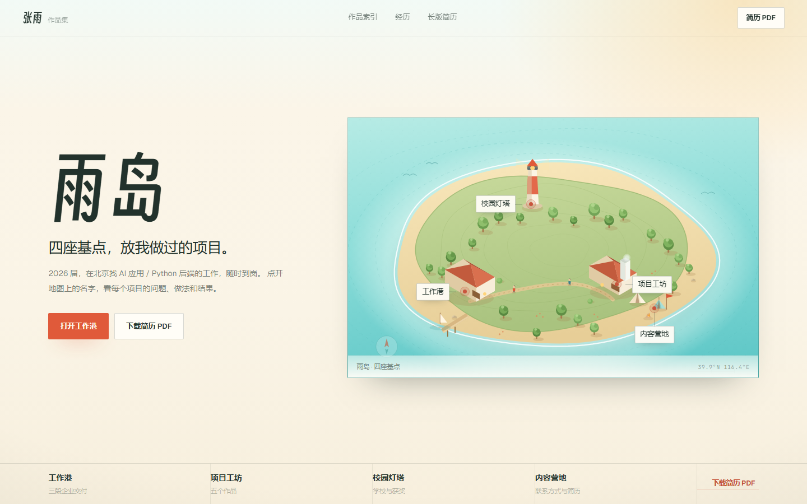

# resume

张雨的求职站：一张阳光下的雨岛插画地图 + 一页 A4 简历。暖米色纸面、蓝绿海水、沙岸、树和小房子。

- **作品集（首页）**：<https://pengyuyan3d.github.io/resume/>
- **长版简历**：<https://pengyuyan3d.github.io/resume/profile/>
- **一页 PDF**：<https://pengyuyan3d.github.io/resume/resume.pdf>

> 推 `main` 后由 GitHub Actions 自动发布，约 1 分钟生效。



## 三个页面

| 路径 | 用途 | 说明 |
| --- | --- | --- |
| `/` | 雨岛作品集 | 首屏是插画岛，四个基地点开看细节；下面还有文字索引 |
| `/profile/` | 长版简历 | 与首页同一套暖色视觉：三段经历 + 七个项目 + 技能/教育/联系 |
| `/resume/` | 打印版 | 浅色 A4 版式，`noindex`，PDF 由它导出 |

## 雨岛怎么用

- 点岛上的 `01–04`、或底部停靠栏、或按键盘 `1–4`，打开右侧抽屉；`Esc` 关闭
- 深链：`/?zone=build` 直接打开「项目工坊」，适合贴在邮件或简历里
- 四个基地：

| 基地 | 放什么 |
| --- | --- |
| 01 工作港 | 三段经历（衔远正式 / 衔远实习 / 星域），带原始 bullet |
| 02 项目工坊 | 七个作品，每个都有配图（真截图或结构示意），按「问题 → 做法 → 结果」写，能点开的都给了链接 |
| 03 校园灯塔 | 学校、GPA、奖学金、数学竞赛，以及这些训练落在工程上的哪一步 |
| 04 内容营地 | 求职状态、GitHub、邮箱电话、可翻的仓库、PDF |

手机上标记只显示编号，名称在下方停靠栏里，避免图上的文字互相压住。

## 改内容

| 想改 | 改哪里 |
| --- | --- |
| 姓名、职位、联系方式、经历、技能、教育 | `src/config.ts`（三个页面共用） |
| 四个基地的文案、作品案例（问题/做法/结果）、仓库、联系方式 | `src/portfolio.ts` |
| 基地标记在岛上的位置 | `src/portfolio.ts` 里 `zones[].x / y`（按 1200×780 的百分比） |
| 地形图本身（等高线、站点图标、指北针） | 改 `tools/gen-map.mjs`，然后 `node tools/gen-map.mjs` 重新生成 `public/island.svg` |
| 3D Demo 的截图 | 覆盖 `public/shots/manual3d.webp`、`public/shots/space3d.webp`（880×550） |

## 技术

- [Astro](https://astro.build/) 5 + [Tailwind CSS](https://tailwindcss.com/) 4，无框架运行时
- 雨岛是**手写的插画地图**：等距小房子、树、帐篷、小人全是 SVG 多边形/路径拼的，配等高线与指北针；没有 Three.js、没有外部图片、没有 CDN，SVG 约 41KB
- 字体：标题用**得意黑**（`public/fonts/smiley.woff2`，按页面用字子集化，84KB）；正文与拉丁用 Geist Variable（`@fontsource` 本地打包）。字体路径写死了 `/resume/fonts/…`，换 `base` 时要一起改
- 无障碍：抽屉有 `role="dialog"` 与焦点循环、标记有 `aria-expanded`、尊重 `prefers-reduced-motion`
- 无 JavaScript 时：抽屉打不开，但下面的「作品索引 / 经历」是完整可读的静态内容

## 本地开发

```bash
npm install
npm run dev      # 开发：http://localhost:4321/resume/
npm run build    # 产物在 dist/
npm run preview  # 预览构建产物
```

## 自检工具

```bash
# 页面体检：坏图、坏链接、重复 id、标题结构、控制台报错、横向溢出
node tools/qa.mjs http://127.0.0.1:4399/resume/

# 截图：起一个独立的 headless Chrome，不占用你正在用的调试浏览器
node tools/shot.mjs --url http://127.0.0.1:4399/resume/ --out shot.png
node tools/shot.mjs --url http://127.0.0.1:4399/resume/ --out full.png --full
node tools/shot.mjs --url http://127.0.0.1:4399/resume/ --out m.png --w 390 --h 844 --mobile
```

`tools/check.mjs` 是旧版体检脚本，连的是 `9222` 调试端口（会新开标签页），保留备用。

## 部署

推 `main` 自动构建发布（GitHub Actions，`.github/workflows/deploy.yml`）。
仓库设置里 Pages 的 Source 是 **GitHub Actions**。

项目站点发布在子路径 `/<仓库名>/`，所以 `astro.config.mjs` 里有：

```js
site: "https://pengyuyan3d.github.io",
base: "/resume",
```

**换仓库名或账号时要同步改这两行**，否则 CSS、图片、图标都会 404。

## 导出 PDF

打印版页面是 `/resume/`，用浏览器打印成 A4 即可；仓库里的 `张雨-简历-Astro.pdf`
是用 Chrome DevTools 的 `Page.printToPDF`（print 媒体、A4）导出的，正好 1 页。

## 来源与许可

最初版式参考 [RyanFitzgerald/devportfolio](https://github.com/RyanFitzgerald/devportfolio)（MIT），
现在是独立重写的设计，仅保留其 MIT 许可证文件作为致谢。改版方向参考抖音
@阿囤囤《AI 时代的求职新标配：个人作品集》，落地方式见 `docs/作品集改版.md`。

## 说明

- 页面包含真实手机号和邮箱，仓库与站点均公开；不想公开就清空 `phone`、把邮箱换成表单。
- 照片是本人素材，公开仓库里包含该图片；如不希望被下载，可以把仓库转私有或把照片换成插画头像。
- 企业项目没有公网 Demo，页面里标了「可面谈演示」，没有放占位链接。
